## What is LangChain and LangGraph?
**LangChain** provides the standardized building blocks and linear pipelines, while **LangGraph** provides the stateful control plane for loops, branching, and autonomous agents.

---

### 1. What They Are & Their General Use

* **LangChain (The Component & Linear Pipeline Library):**
* **What it is:** An open-source integration framework that gives you a uniform interface across 600+ LLMs, embedding models, document loaders, text splitters, and vector databases. That is why switching from `ChatOpenAI` to `ChatGoogleGenerativeAI` in your `main.py` only required changing one import and class name while keeping `.invoke()` identical.
* **General use:** Ideal for **predictable, forward-moving pipelines** (`Step A → Step B → Step C`)—such as summarizing documents, extracting structured JSON from text, or running a straightforward question-answering chain.


* **LangGraph (The Stateful Graph & Agent Orchestrator):**
* **What it is:** An orchestration framework built on top of LangChain that models your application as a **directed state machine** (made of **State**, **Nodes**, and **Conditional Edges**) rather than a one-way pipe.
* **General use:** Essential whenever an AI workflow needs **cycles (loops), conditional routing, shared memory (`State`), or persistence/checkpoints**—such as multi-agent collaboration, self-correcting code/research agents, or workflows that pause for human approval (`interrupt()`) and resume later.


---

### 2. How Both Are Used Specifically in Your RAG Course

In a production RAG architecture, **LangChain handles the data ingestion and basic retrieval pipeline, while LangGraph upgrades retrieval into an intelligent, self-correcting loop:**

| Layer in Your Project | Framework Used | What It Actually Does |
| --- | --- | --- |
| **Document Ingestion & Parsing** | **LangChain** (`langchain_community`, `langchain_text_splitters`) | Standardizes loading PDFs (`PyPDFLoader`), text files (`TextLoader`), and web pages into unified `Document(page_content, metadata)` objects, then splits them into chunks.

 |
| **Embeddings & Vector Store** | **LangChain** (`langchain_google_genai`, `pgvector`) | Converts chunks into vectors and exposes your database as a standard `.as_retriever()` tool. |
| **Basic (Naive) RAG** | **LangChain** (LCEL Chains) | Runs a linear one-shot pipe: `Query → Retrieve top-k chunks → Stuff into prompt → Generate answer`. Works when the first retrieval hits the right data, but hallucinates or fails if the retrieved chunks are irrelevant. |
| **Agentic / Self-Correcting RAG** | **LangGraph** (`StateGraph`, `Nodes`, `Conditional Edges`) | Turns retrieval into a decision loop:<br>

<br>1. **Router Node:** Decides whether the query even needs a vector DB search or can be answered directly.<br>
<br>2. **Grader Node:** Inspects the retrieved chunks to check if they actually answer the question.<br>
<br>3. **Conditional Edge (Loop):** If the chunks are irrelevant, routes backward to a **Query Rewrite Node** to rephrase the search and retry—only moving to the **Generate Answer Node** once grounded context is confirmed. |

In short: right now in `document_loaders.py`, you are building the **LangChain** foundation (turning raw files into clean `Document` objects). Later in the course, you will wrap those LangChain retrievers inside **LangGraph** nodes so your RAG system can grade its own search results, rewrite bad queries, and loop until it finds the right context.

## What is the use of uv?

In a multi-library RAG project, **`uv` acts as a unified, ultra-fast project manager** that replaces `pip`, `venv`, `requirements.txt`, and `pyenv` with a single tool.

Specifically, here is why the instructor uses it for this course:

* **Solves AI Dependency Hell (10–100x Faster):** Production RAG stacks combine fast-moving libraries (`langchain`, `langgraph`, `pgvector`, `fastapi`, `pydantic`, embedding models) whose sub-dependencies frequently clash. Unlike `pip`—which installs packages sequentially and can leave broken version conflicts—`uv` is written in Rust and resolves the entire dependency graph upfront in seconds.
* **Zero-Friction Virtual Environments (`.venv`):** Every `uv add` or `uv run` automatically creates and uses a project-isolated `.venv` folder. You never pollute your system Python or manually run `activate` scripts before executing code.
* **True Cross-Platform Reproducibility (`pyproject.toml` + `uv.lock`):** When you run `uv add`, it records your high-level packages in `pyproject.toml` and pins the exact versions and hashes of every nested sub-dependency in `uv.lock`. If you push your RAG project to GitHub and deploy it to a Linux server or Docker container later, running `uv sync` recreates the exact same environment without "works on my machine" crashes.
* **Automatic Python Version Pinning (`.python-version`):** ML and vector libraries often lag behind the newest Python release. `uv` locks the project to a compatible Python version (via `.python-version`) and can download/manage that exact interpreter automatically if your machine doesn't have it.

### Workflow Comparison

| Task | Traditional `pip` + `venv` | `uv` Workflow |
| --- | --- | --- |
| **Start project** | `mkdir app && cd app && python -m venv .venv` | `uv init` |
| **Activate env** | `source .venv/bin/activate` (every terminal session) | Not required (`uv run` handles it automatically) |
| **Install library** | `pip install langchain` + manually update `requirements.txt` | `uv add langchain` (installs + updates `pyproject.toml` & `uv.lock`) |
| **Run script** | `python main.py` (fails if you forgot to activate `.venv`) | `uv run main.py` |
| **Clone & setup repo** | `python -m venv .venv` + `pip install -r requirements.txt` | `uv sync` |

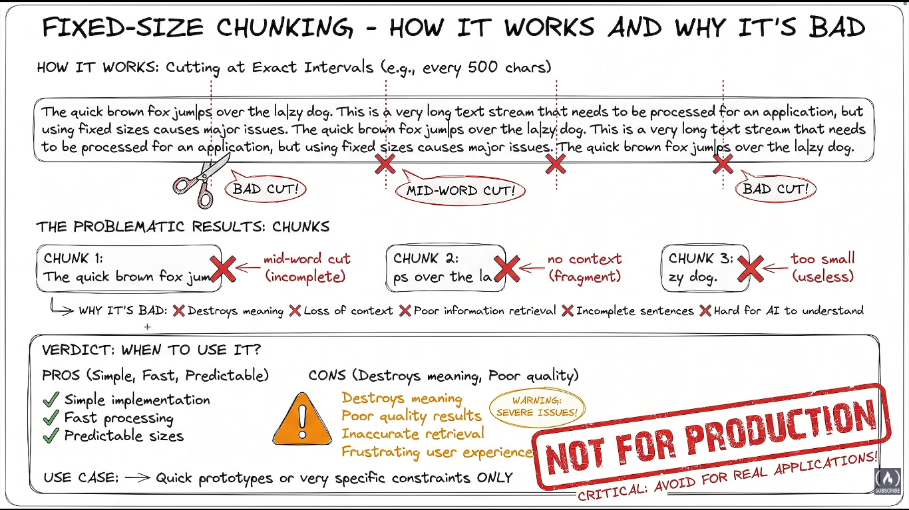

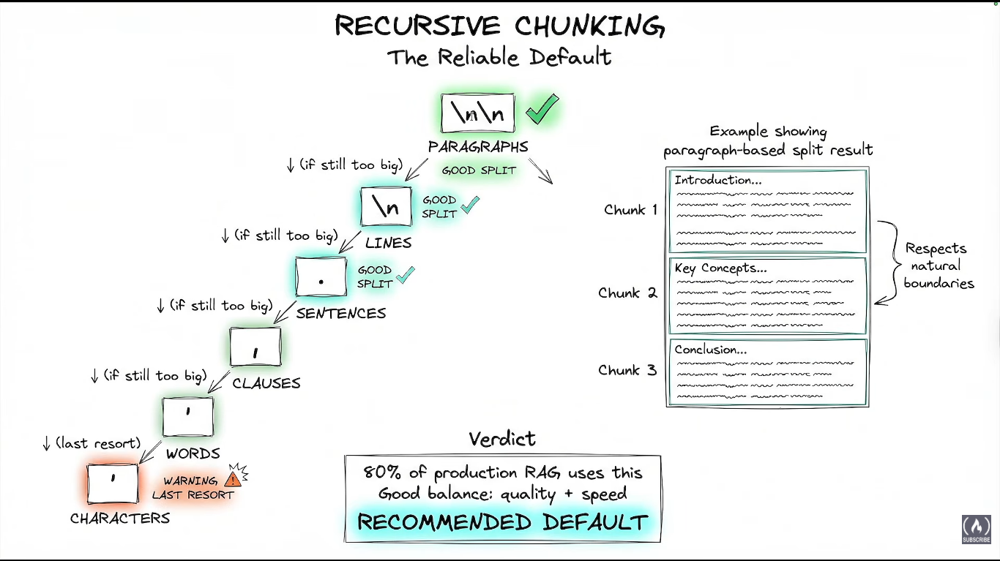

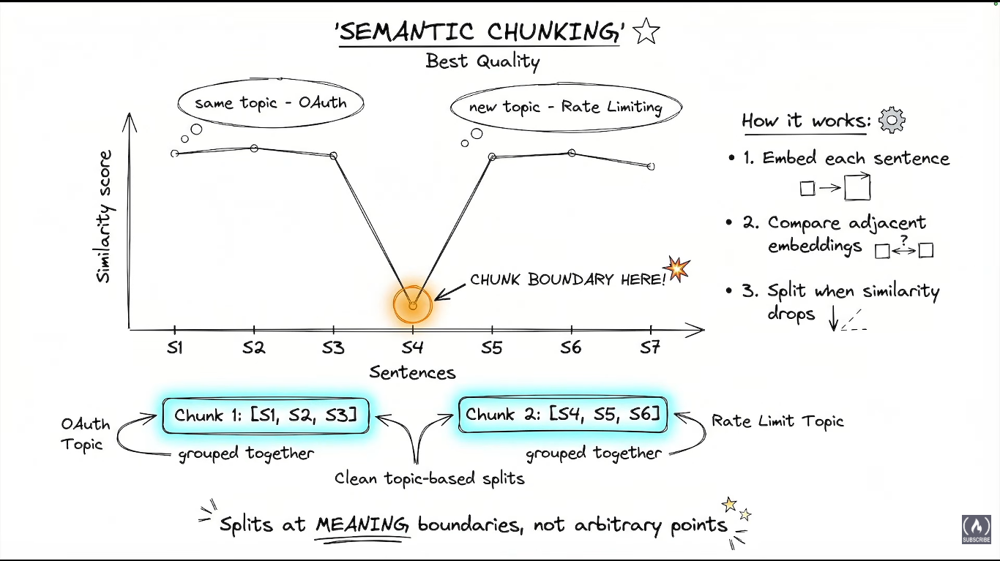

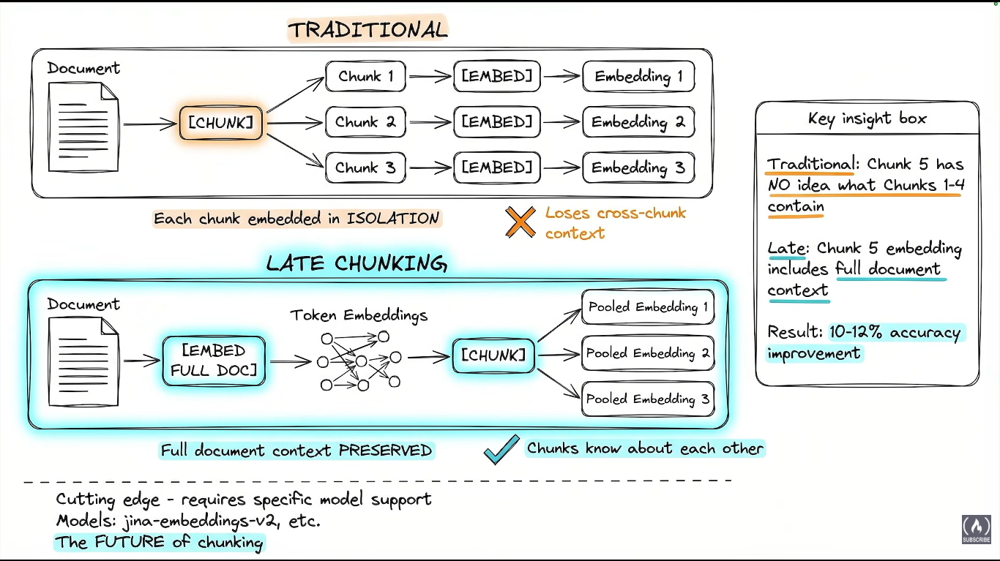

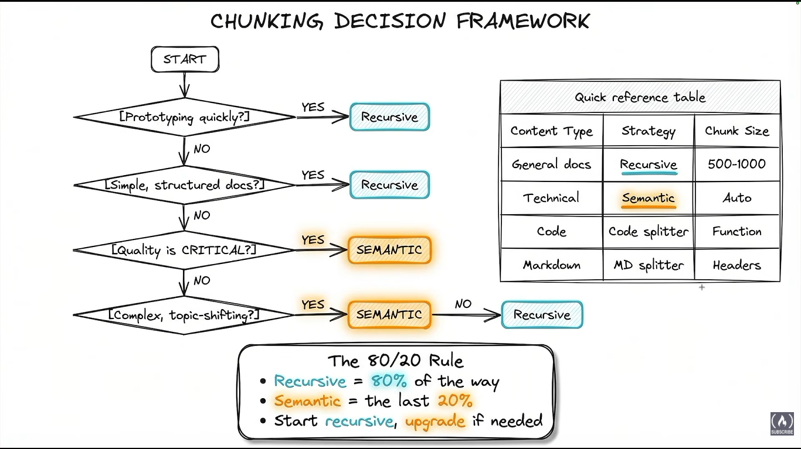

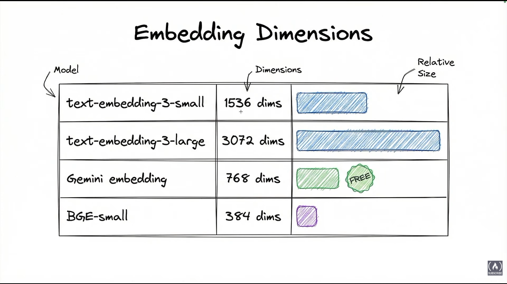

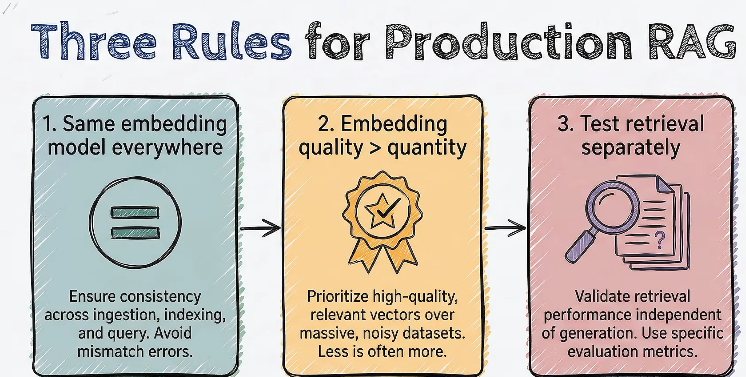

## What is Chroma DB? How is it useful in this RAG model?
**Chroma** is an open-source **embedding (vector) database** designed specifically for AI and LLM applications. Instead of searching only for exact keyword matches like a traditional SQL table, Chroma stores your text chunks alongside numerical vector **embeddings**—arrays of numbers that capture semantic meaning—and retrieves chunks whose meanings are closest to a user's query.

### How Chroma Works Under the Hood

* **Collections:** Similar to a table in a relational database, Chroma organizes data into **collections** (e.g., a collection for course notes, a collection for PDFs).
* **Documents + Embeddings + Metadata:** For each chunk you add, Chroma stores the original text (`documents`), its vector representation (`embeddings`), and key-value tags (`metadata`, such as source filename, page number, or topic).
* **Similarity Search:** When you query Chroma with a question, your query is embedded into the same vector space, and Chroma finds the nearest vectors (using distance metrics like cosine similarity or L2) and returns the matching chunks.

---

### How It Is Useful in Your Case (Your Course & RAG Build)

1. **Fast Local Prototyping Without Cloud Setup:** Right now on your Windows machine (`F:\coding\Projects\RAG_langchain_vecDB`), you don't need to spin up a remote database server or manage cloud credentials just to test document loading, chunking strategies, and retrieval quality. Chroma can run in-memory or persist directly to a local folder on disk (e.g., `./chroma_db`)—great when pairing with your free Gemini API setup.
2. **Smooth LangChain Integration:** Once you split your loaded documents (`TextLoader`, `PyPDFLoader`) into chunks, you can wrap Chroma as a LangChain vector store and expose it via `.as_retriever()` inside chains or **LangGraph** nodes without rewriting retrieval logic when you later swap components.
3. **Metadata Filtering for Precision:** Attaching metadata (like document name or section) lets you filter searches before or alongside vector similarity—helpful if you test on multi-document sets or your own resume/notes so answers stay grounded in the right source.
4. **Stepping Stone to Production Vector Stores:** Chroma is ideal for learning vector indexing, chunking trade-offs, and retrieval evaluation quickly. Later—when you move into full production deployment, multi-user concurrency, or larger-scale datasets (as covered in production RAG architectures and PostgreSQL/pgvector workflows)—you'll already understand the core concepts of embeddings, similarity search, and metadata filtering that carry over directly.

### Quick Setup Note (Using `uv`)

When the course reaches the Chroma lesson, install it into your `.venv` with `uv add chromadb langchain-chroma` (matching your embedding provider—such as Google's embedding model with `langchain-google-genai`) rather than `pip install`.

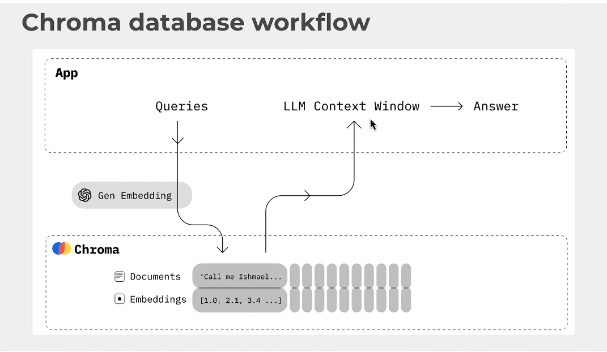

### Flow of a RAG Query with Chroma DB
1) The user submits a query (e.g., "What is LangChain?").
2) The application generates an embedding for that query using a same neural network or a similar model.
- This embedding tranforms the query into a format suitable for Chroma DB for processing.
3) The query embedding is compared with existing embeddings in the Chroma DB collection to find the most semantically similar chunks.
4) The top-k most relevant chunks are retrieved and passed to the LLM for generating a response.

### Why 90% RAG model fail in production?
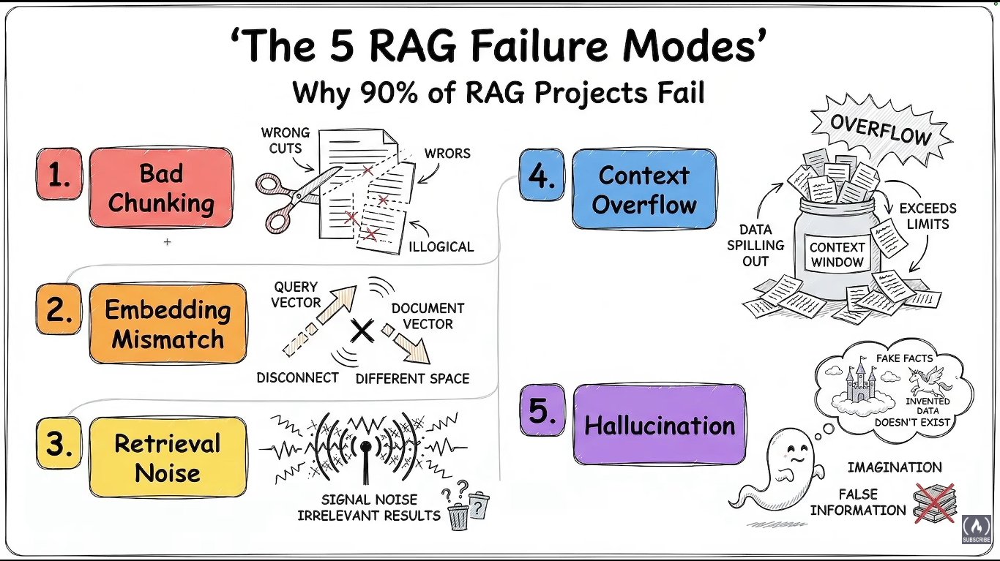

1) Bad Chunking: If the text is split into chunks that are too small or too large, the model may not have enough context to generate accurate answers. For example, if a chunk contains only a single sentence, the model may not understand the broader context of the document.
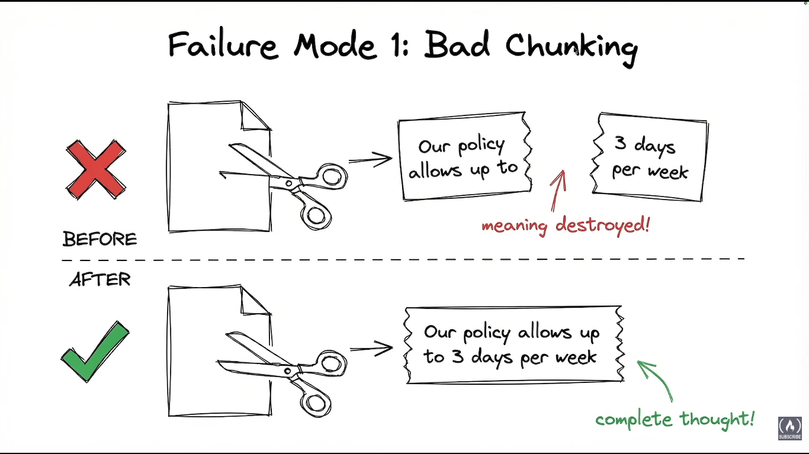

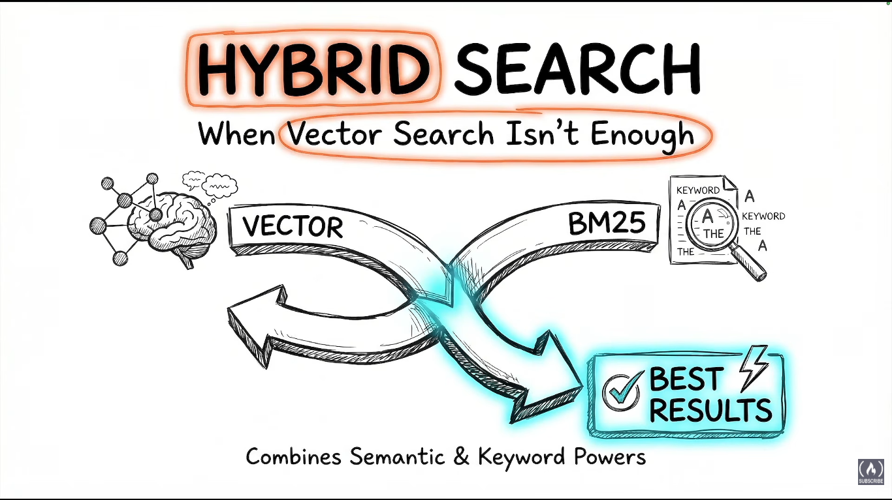

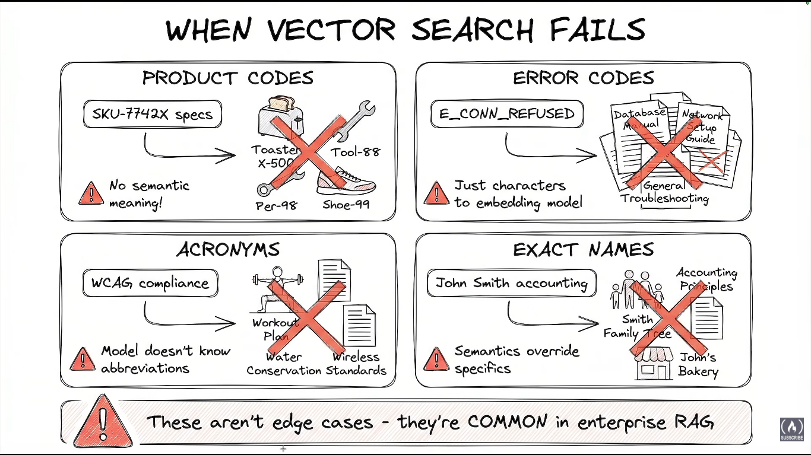

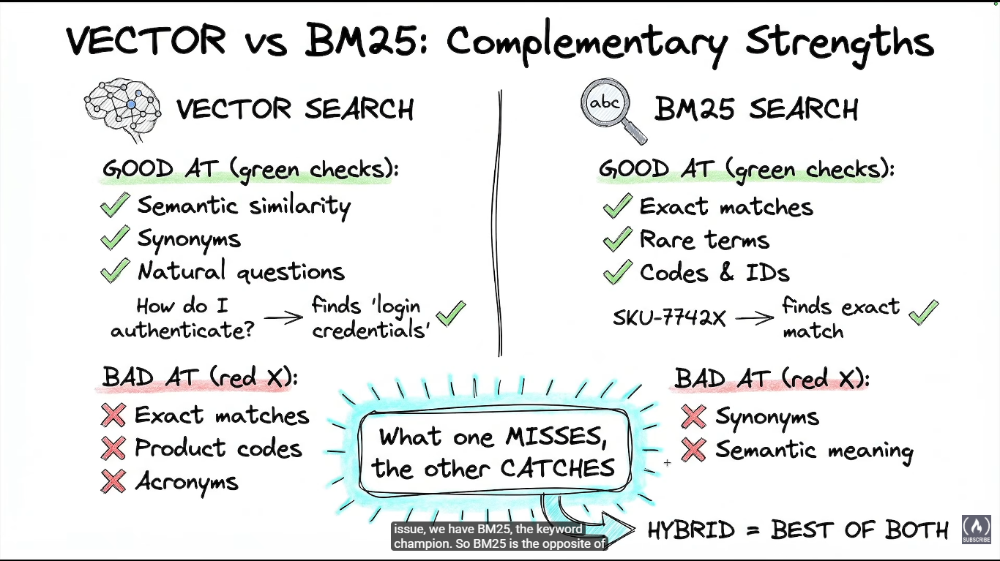

###

**BM25** (short for **Best Matching 25**) is a classic, high-performing **lexical (keyword-based) ranking algorithm** used in information retrieval and search engines. Rather than turning text into dense semantic vectors like an embedding model does, BM25 scores documents based on exact word matches, how often a term appears, and how rare that term is across your corpus.

---

## What is BM25? How it works? How is it useful for RAG models?

Given a user query $Q = \{q_1, q_2, \dots, q_n\}$ and a document (or chunk) $D$, BM25 calculates a relevance score by combining three core signals:

1. **Term Frequency (TF) with Saturation ($k_1$):**
* The more times a query word appears in a chunk, the more relevant that chunk likely is—*up to a point*.
* Unlike raw TF (or classic TF-IDF), BM25 applies **diminishing returns** controlled by parameter $k_1$ (typically `1.2` to `2.0`). Mentioning a keyword 20 times doesn't make a chunk 10× better than mentioning it 3 times; it prevents keyword stuffing and long-document bias.


2. **Inverse Document Frequency (IDF):**
* Common words (like `"the"`, `"model"`, or `"system"`) carry low weight because they show up everywhere.
* Rare, specific terms (like `"WinError 32"`, `"HNSW"`, `"k_1"`, or a specific class name or error code) get a high boost when matched.


3. **Document Length Normalization ($b$):**
* Parameter $b$ (typically `0.75`) compares a chunk's length against the average chunk length across the corpus (`avgdl`).
* A single match inside a short, focused chunk counts for more than a single match buried inside a massive chunk.


A standard formulation of the BM25 score for document $D$ and query $Q$ is:

$$\text{score}(D, Q) = \sum_{i=1}^{n} \text{IDF}(q_i) \cdot \frac{f(q_i, D) \cdot (k_1 + 1)}{f(q_i, D) + k_1 \cdot \left(1 - b + b \cdot \frac{\vert{}D\vert{}}{\text{avgdl}}\right)}$$

where $f(q_i, D)$ is the frequency of term $q_i$ in document $D$, $\vert{}D\vert{}$ is the document's length, and $\text{avgdl}$ is the average document length across the collection.

---

### Why BM25 Is Useful in RAG Models

Pure vector search (dense embeddings + Chroma) excels at **semantic/conceptual matching**—for example, matching *"How do I stop Chroma from locking temp files on Windows?"* to a chunk about file handles even without exact word overlap. However, dense embeddings have blind spots that BM25 covers well:

* **Exact identifiers, error codes, and technical terms:** Embeddings can blur together similar-sounding APIs, model names, versions, flags, or error codes (e.g., `WinError 32` vs. `WinError 5`, or `gemini-embedding-001` vs. another model name). BM25 nails exact token matches.
* **No embedding API calls or latency for indexing:** BM25 builds an inverted index locally from tokens—meaning zero embedding quota/rate-limit usage and instant indexing when experimenting with chunk sizes on large PDFs.
* **Strong baseline & domain shift resilience:** Because it doesn't rely on neural representations trained on general internet text, BM25 stays reliable on niche acronyms, internal IDs, or specialized jargon.

---

### Where BM25 Fits in Production RAG: Hybrid Search

In production RAG systems, BM25 rarely replaces vector search—instead, they are paired in **Hybrid Search**:

1. **Parallel Retrieval:** Run a **BM25 retriever** (keyword/lexical) and a **vector retriever** (semantic, e.g., Chroma) on the same chunks.
2. **Rank Fusion (e.g., Reciprocal Rank Fusion / RRF):** Merge and re-rank the two candidate lists so chunks that rank high in *either* or *both* rise to the top.
3. **Optional Reranking:** Pass the fused top-$N$ chunks to a cross-encoder reranker before feeding the final context into your LLM prompt.

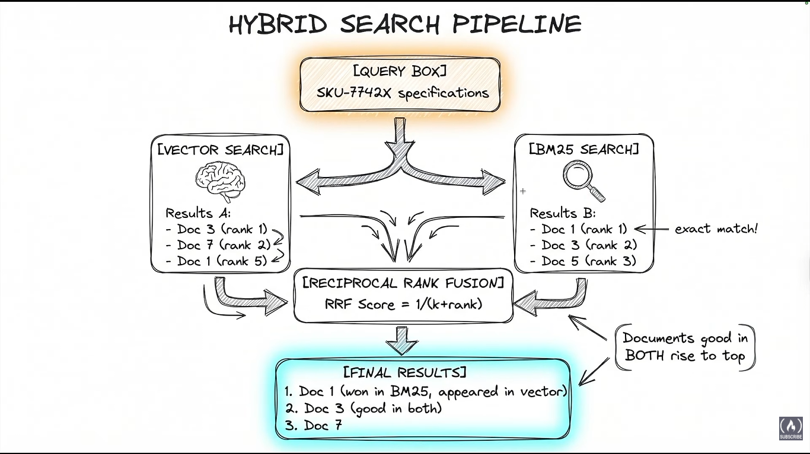

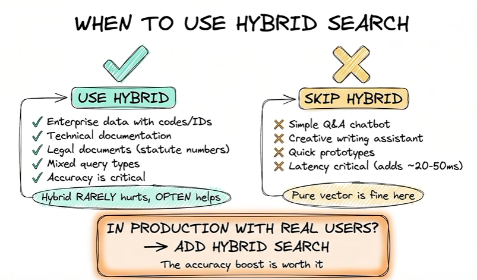

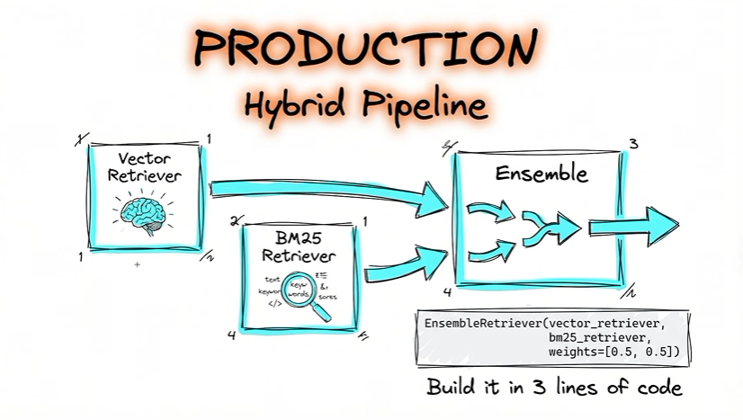

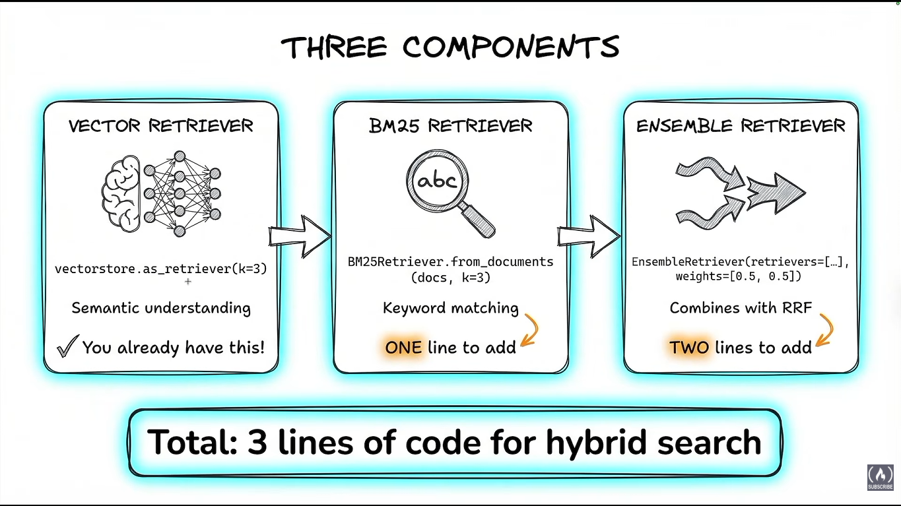

```python
# create vector retriever
vector_retriiver = vectorstore.as_retriever(
    search_kwargs={"k": 5}, #return top 5
)
print("Vector retriever created.")

# create BM25 retriever
bm25_retriever = BM25Retriever.from_documents(
    documents,
    k=5,  # return top 5
)
print("BM25 retriever created.")

# combine with ensembleRetriever object
ensemble_retriever = BM25Retriever.combine_retrievers(
    retrievers=[vector_retriiver, bm25_retriever],  
    weights=[0.5, 0.5],  # equal weights for both retrievers
)
print('Hybrid retriever ready')
```

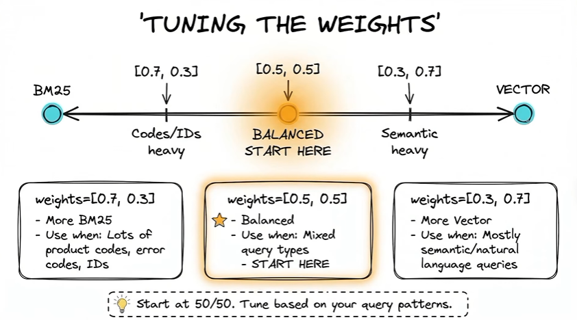

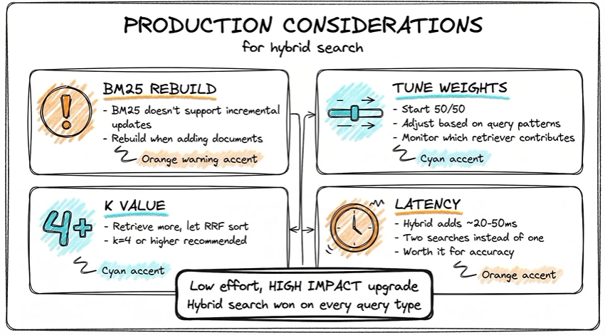